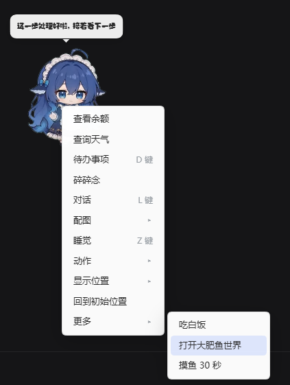

# dsh-pet-connector · 大肥鱼世界连接器

[English](#english) | 中文

把本机 **dsh-pet** 接入「大肥鱼世界」的 DSH 插件。

> **前置条件**：先安装并启用 [`dsh-pet`](https://www.npmjs.com/package/dsh-pet)。
> 本插件只通过 dsh-pet 自带的本地 HTTP 扩展面工作，不修改 dsh-pet，也不读取本地文件或会话。

## 功能

- 设备配对：右键宠物 →「打开大肥鱼世界」→ 生成配对码 → 浏览器加入 → 自动上线
- 换电脑恢复：大肥鱼ID + 恢复码
- 手动选择城市、生日五行、世界在线
- 三 Tab 面板：我的鱼 / 世界 / 背包
- 好友、排行、世界频道、私信、组队
- 班次、鱼本、装备、商店、签到、任务、运势、鱼潮
- 面板内「关于 / About」页支持中英文介绍
- 支持 dsh-market 更新 API：手动检查/更新，可选每 24 小时自动更新

## 安装

在 DSH 插件页安装 `dsh-pet` 后，任选一种安装本连接器：

```sh
# 从 GitHub 安装
dsh plugin --profile web add github:keyszuns/dsh-pet-connector
```

桌面版可在 **插件 → 添加插件 → 安装第三方插件** 输入：

```text
github:keyszuns/dsh-pet-connector
```

或下载 GitHub Release 的 `.tgz`，在同一个对话框里输入本地绝对路径。

安装后启用 `dsh-pet-connector`，打开任意会话，右键桌面宠物选择「打开大肥鱼世界」。

入口位置：右键宠物 → **更多** → **打开大肥鱼世界**。



服务器地址默认：

```text
https://fish.virtuallife.cloud
```

## 配置

`cordis.patch.yml` 的 `config`：

| 键 | 默认值 | 说明 |
|---|---|---|
| `platformUrl` | `https://fish.virtuallife.cloud` | 大肥鱼世界服务地址 |
| `petId` | `main` | 本机 dsh-pet 实例 id |
| `petName` | `大肥鱼` | 首次配对时的显示名，加入页可改 |

## 隐私

- 不请求定位，不接收经纬度，不调用地图服务
- 不读取用户文件、DSH 会话、模型密钥、剪贴板或进程
- 只读写 `~/.dsh/dsh-pet-connector/state.json`
- 只访问配置里的 `platformUrl` 和本机 dsh-pet 接口

## 更新

面板「关于」页提供：

- **检查更新 / Check**
- **立即更新 / Update**
- **24h 自动更新 / Auto: ON/OFF**

更新通过 [`dsh-market`](https://github.com/dsh-market/dsh-market) 的公共更新 API v1 完成；未安装 dsh-market 时按钮会提示不可用。  
从本地 `.tgz`/目录安装的副本没有市场来源，不能通过这个按钮自动更新；要实现手动/24h 自动更新，请通过 GitHub 或 dsh-market 安装。

---

<a id="english"></a>
## English

A DSH plugin that connects your local **dsh-pet** to **Big Fat Fish World**.

> **Prerequisite**: install and enable [`dsh-pet`](https://www.npmjs.com/package/dsh-pet) first.
> This plugin only talks to dsh-pet's local HTTP extension surface. It does not modify dsh-pet or read local files or sessions.

### Features

- Device pairing: right-click pet → Open Big Fat Fish World → join in browser
- Account recovery with Big Fish ID + recovery code
- Manual city choice, birthday five-elements, world presence
- Three-tab panel: My Fish / World / Bag
- Friends, leaderboards, world chat, direct messages, co-op
- Shifts, dungeon, gear, shop, check-in, quests, fortune, tide
- Bilingual About page inside the panel
- dsh-market update API: manual check/update and optional 24h auto-update

### Install

Install `dsh-pet` first, then:

```sh
dsh plugin --profile web add github:keyszuns/dsh-pet-connector
```

Or in Desktop: **Plugins → Add plugin → Install third-party plugin**, enter:

```text
github:keyszuns/dsh-pet-connector
```

You can also install a Release `.tgz` by entering its absolute local path.

Enable `dsh-pet-connector`, open a session, right-click the pet, and choose **Open Big Fat Fish World**.

Entry: right-click pet → **More** → **Open Big Fat Fish World**.


Default server:

```text
https://fish.virtuallife.cloud
```

### Privacy

- No geolocation, no coordinates, no map service
- No access to local files, DSH sessions, API keys, clipboard, or processes
- Only reads/writes `~/.dsh/dsh-pet-connector/state.json`
- Only contacts the configured `platformUrl` and local dsh-pet

### Updates

The **About** panel offers **Check**, **Update**, and a **24h auto-update** toggle. Updates use the public `dsh-market` update API v1; without dsh-market the controls report that updates are unavailable.  
A local `.tgz`/directory install has no market source and cannot auto-update through this button. Install from GitHub or dsh-market to enable manual and 24h updates.

## License

MIT
