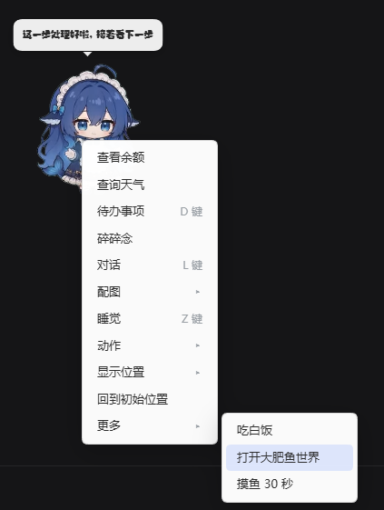

# Big Fat Fish World Connector

> **Don't just fish — you can also cultivate immortality!** Besides fishing, the dungeon and daily life, enter a separate text-cultivation realm: eight regions unlocked by realm, five-minute runs, manual breakthroughs, primary techniques, alchemy and breakthrough pills.


English | [中文](DETAIL.zh.md)

Connects your local **dsh-pet** to **Big Fat Fish World**. The connector does not modify dsh-pet or bundle its assets; it only uses dsh-pet's local HTTP extension surface (`/dsh-pet-7340/*`) to read state, write work status, and make the pet speak.

## Features

- **Device pairing**: right-click pet → Open Big Fat Fish World → generate a pairing code → join in the browser → auto-online
- **Account recovery**: Big Fish ID + recovery code restores an account on a new computer
- **Join page**: consent, manual city selection, birthday; no geolocation
- **Five elements**: birthday defines zodiac and nayin; city defines regional five-elements
- **Shifts**: 15/30/60 minutes, server-authoritative settlement
- **Dungeon**: solo/co-op, Lv10 unlock, daily limits and drops
- **Cultivation realm**: independent cultivation level and title, eight realm-gated regions, five-minute timed logs, manual major-realm breakthroughs, primary techniques, alchemy, breakthrough pills, and a cultivation leaderboard
- **Gear/shop**: buy, enhance, equip, dismantle, set bonuses, codex
- **Three-tab panel**: My Fish / World / Bag
- **Social**: friends, leaderboards, world chat, DMs, visits, co-op
- **About page**: bilingual introduction, version, manual update, optional 24h auto-update

## Privacy boundaries

- No geolocation, no coordinates, no map service
- No access to user files, DSH sessions, model keys, clipboard, or processes
- Only reads/writes its own `~/.dsh/dsh-pet-connector/state.json`
- Only contacts the configured `platformUrl` and the local dsh-pet API

## Install

1. Install and enable [`dsh-pet`](https://www.npmjs.com/package/dsh-pet).
2. Install this connector in the DSH plugin manager:

```sh
dsh plugin --profile web add github:keyszuns/dsh-pet-connector
```

Or in **Plugins → Add plugin → Install third-party plugin**, enter:

```text
github:keyszuns/dsh-pet-connector
```

3. Enable `dsh-pet-connector` and open any session.
4. Right-click the desktop pet → Open Big Fat Fish World → generate a pairing code → join in browser.

Entry: right-click pet → **More** → **Open Big Fat Fish World**.



## Configuration

| Key | Default | Description |
|---|---|---|
| `platformUrl` | `https://fish.virtuallife.cloud` | Big Fat Fish World server URL |
| `petId` | `main` | Local dsh-pet instance id |
| `petName` | `大肥鱼` | Display name used for first pairing |

## Updates

The **About** tab provides **Check**, **Update**, and an optional **24h auto-update** toggle. Updates use the public `dsh-market` update API v1; without dsh-market the controls report that updates are unavailable.

Requires DSH 0.2.1+. See [README](../README.md) for development and installation.
